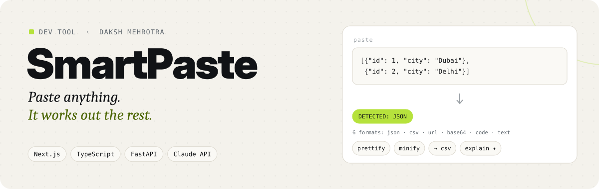

<picture>
  <source media="(prefers-color-scheme: dark)" srcset="assets/banner-dark.svg">
  
</picture>

<br>

**SmartPaste** is a small developer utility for the snippets you copy all day. Paste anything, and it works out what you've got (JSON, CSV, a URL, Base64, code or plain text), then offers only the transforms that make sense for it. When you just need to know what something *is*, **Explain** asks Claude for a 3–5 sentence summary written for a developer.

## What it can do

| Detected as | Transforms offered |
|---|---|
| JSON | Prettify · Minify · JSON → CSV · Explain |
| CSV | Explain |
| URL | URL-encode · URL-decode · Explain |
| Base64 | Decode · Explain |
| Code | Explain |
| Text | Base64-encode · URL-encode · Explain |

Detection is rule-based and runs in order: valid JSON first, then an `http(s)://` prefix, comma-separated multi-line content, a strict Base64 shape (charset, padding, length divisible by 4), common language keywords, and finally plain text. Everything except **Explain** runs locally on the server with no model call.

## Stack

| Layer | Tools |
|---|---|
| Frontend | Next.js, React, TypeScript, Tailwind CSS |
| API | FastAPI: `POST /api/detect`, `POST /api/transform` |
| AI | Anthropic Claude API (Explain only) |

## Run it locally

```bash
# backend (http://127.0.0.1:8000)
cd backend
python3 -m venv venv && source venv/bin/activate
pip install -r requirements.txt
export ANTHROPIC_API_KEY=...        # only needed for Explain
uvicorn app.main:app --reload --port 8000

# frontend (http://localhost:3000)
cd ../frontend
npm install
npm run dev
```

The frontend is deployed on Vercel (see the link in the repo's About section). It talks to the API at `127.0.0.1:8000`, so detection and transforms work when the backend is running on your machine.
